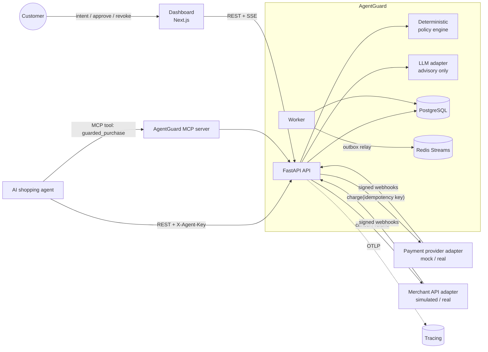
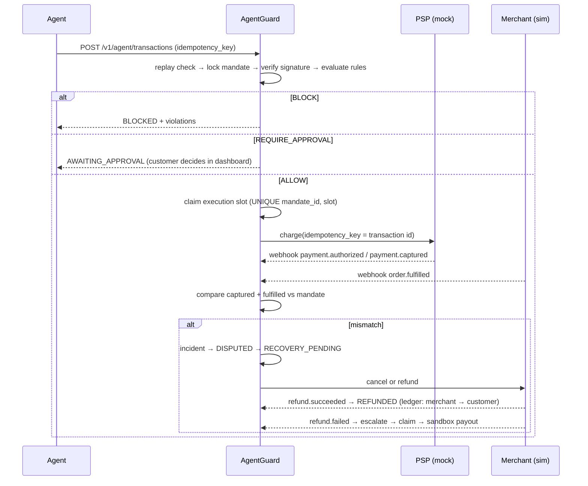

# Architecture

## System context

## Boundaries

| Layer | Responsibility | May move money? |
|---|---|---|
| `adapters/llm.py` | Interpret intent, explain incidents | **No** — output is schema-validated and advisory |
| `domain/policy.py` | Pure, deterministic rules (no I/O, no clock) | Decides, never executes |
| `domain/state_machine.py` | Single source of valid transitions | — |
| `services/transactions.py` | Idempotency, locking, slot claiming, execution | Via payment adapter |
| `services/events.py` | Webhook ingestion, ordering, post-execution verification | — |
| `services/recovery.py` | Cancellation / refund / retry / escalation | Via merchant adapter |
| `services/claims.py` | Eligibility + limits, sandbox payout | Sandbox ledger only |
| `services/audit.py` | Hash-chained audit + outbox | — |

## Purchase flow

## Duplicate-execution safety (defence in depth)

1. **Idempotency key** — `UNIQUE(transactions.idempotency_key)`; same key + same payload hash ⇒ original result; same key + different payload ⇒ `409`.
2. **Mandate row lock** — `SELECT … FOR UPDATE` serializes attempts per mandate, with a double-checked idempotency lookup after acquiring the lock.
3. **Execution slots** — `UNIQUE(mandate_id, execution_slot)`. If the lock were bypassed, the database still rejects a second execution; the engine converts that into `BLOCKED: DUPLICATE_EXECUTION`.
4. **PSP idempotency** — the payment adapter is called with the transaction id as its idempotency key.

Verified by `tests/test_concurrency.py` (12 parallel threads ⇒ exactly one `AUTHORIZED`).

## Webhook processing

- HMAC-SHA256 signature over the raw body (`X-Signature`).
- `UNIQUE(provider_events.event_id)` ⇒ at-least-once delivery is safe (`DUPLICATE`).
- Per-transaction, per-source sequence cursor: `seq ≤ cursor` ⇒ `STALE`; `seq > cursor + 1` ⇒ `DEFERRED`, drained automatically when the gap fills; the worker force-applies deferred events after `AG_DEFERRED_EVENT_TIMEOUT_S`.

## Tamper evidence

Each audit record stores `sha256(prev_hash + canonical(record))`. `GET /v1/audit/verify` recomputes the chain and reports the first broken sequence. On PostgreSQL a trigger rejects `UPDATE`/`DELETE` on `audit_records`. Mandate versions are HMAC-signed and re-verified at every evaluation, so editing a mandate row directly yields `SIGNATURE_INVALID`.

## Observability

- `X-Correlation-ID` accepted or generated per request, propagated into audit records, outbox events and JSON logs.
- OpenTelemetry FastAPI instrumentation when `AG_OTEL_EXPORTER_ENDPOINT` is set (`docker compose --profile observability up` starts Jaeger).
- Transactional outbox (`domain_events`) → Redis Stream `agentguard.events`; the dashboard consumes SSE from `/v1/stream`.

## AWS deployment shape

| Component | AWS |
|---|---|
| API, worker | ECS Fargate services (same image), ALB in front of the API |
| PostgreSQL | RDS for PostgreSQL (Multi-AZ) |
| Redis | ElastiCache for Redis |
| Secrets (`AG_SIGNING_SECRET`, `AG_WEBHOOK_SECRET`, LLM keys) | Secrets Manager → ECS task secrets; signing could move to KMS (asymmetric keys) |
| Dashboard | Amplify Hosting or ECS + CloudFront |
| Tracing / logs | ADOT collector → X-Ray; CloudWatch Logs (JSON) |
| Webhooks ingress | ALB + WAF; optional SQS buffer in front of ingestion |

## Simulated vs real

Simulated components are isolated behind ports (`PaymentProvider`, `MerchantApi`) and flagged `simulated = True`. Every ledger row is `sandbox = true`; the API and dashboard label all payouts as simulated.
